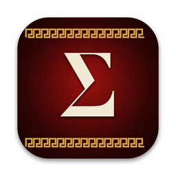
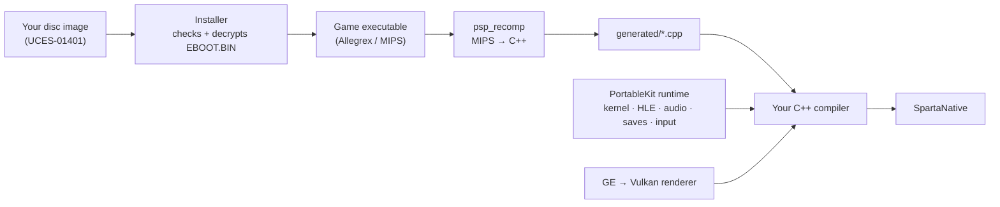

<div align="center">



# Sparta

**God of War: Ghost of Sparta (PSP), recompiled to run natively on your computer.**

[](docs/MISSING.md)
[-lightgrey?logo=apple)](#status)
[](#tech-stack)
[](#tech-stack)
[](https://github.com/TeamGDB/PortableKit)
[](LICENSE)

[Status](#status) · [How it works](#how-it-works) · [Tech stack](#tech-stack) · [Repository layout](#repository-layout) · [Building](#building-and-playing) · [Controls](#controls) · [Credits](#credits)

</div>

---

Sparta is a native port made by **static recompilation**: the game's PSP code is translated ahead of time into C++ and compiled for your machine, then run on a reimplementation of the PSP system software, drawing on the GPU through Vulkan. It is not a decompilation, and not an emulator in the usual sense: there is no JIT and no interpreter in normal play.

> [!WARNING]
> **Work in progress.** Only the opening of the game has been played, on one machine. Expect bugs, graphical glitches, crashes and breaking changes, including to where settings and saves are kept.

> [!IMPORTANT]
> **No game data is included.** This repository contains no disc image, no executable, no code generated from the game, and no art, audio or video from it. You need your own legally obtained copy of the game — the European release, `UCES-01401` — as a disc image of your own UMD. Nobody here can give you a copy or tell you where to get one. Sparta is not affiliated with, endorsed by or sponsored by Sony Interactive Entertainment, Santa Monica Studio or Ready At Dawn.

## Status

**The title menu, the opening cutscene and the first level (the boat) play** — recompiled, at 60 frames a second and full speed, with no audio underruns.

| | |
| --- | --- |
| **Tested on** | macOS 26, Apple Silicon (M4), Vulkan through MoltenVK |
| **Not tried yet** | Windows, Linux, Android — PortableKit builds there; this port has never been run there |
| **Release** | `UCES-01401`, European, v1.00 — the installer checks the disc id and the SHA-256 of the executable |
| **Imports the game makes** | 206, of which 2 have no implementation (`sceKernelLoadExec`, `sceAtracSetAA3DataAndGetID`); neither has been seen called |
| **Recompiled** | 22 159 functions · 1 036 824 blocks · 254 C++ units |
| **Not lowered by the recompiler** | only the game's own 44 `break` traps |

What is known to be missing is in [`docs/MISSING.md`](docs/MISSING.md).

## How it works



1. **The installer** reads your disc image, checks it is the supported release, and decrypts `EBOOT.BIN` into the game's executable.
2. **The recompiler** (`psp_recomp`) analyses that executable and writes every function of the game's Allegrex (MIPS) code as C++.
3. **Your compiler** builds that C++ together with the runtime: a reimplementation of the PSP kernel and system modules, audio (SAS, ATRAC3, movies), save data, input, and a GE renderer that translates the PSP's graphics command lists to Vulkan.

<details>
<summary><b>What this port needed beyond a profile of constants</b></summary>

- **PGD data.** One of the game's files (`ATT_000_STARTSCREEN.BIN`) is PGD-encrypted. The port carries the published PGD keys (`host/sparta_keys.cpp`), each checked against PortableKit's fingerprints.
- **New render targets start as zeros.** The game's bloom is drawn in steps side by side inside one 512-pixel-wide buffer and samples around what it drew; undefined target contents showed as a magenta tint over the whole picture.
- **One flip a vblank.** The game's frame loop waits only on the GE, which takes no emulated time here, so it flipped about ten times a vblank and then stalled for 100 ms at once. The profile caps it at one flip a vblank (`flips_wait_for_vblank`) — the same idea PPSSPP applies to the God of War games — and runs it at the game's own 60 frames a second.

The two framework changes live on the `sparta` branch of [a fork of PortableKit](https://github.com/arnaldolima1/PortableKit/tree/sparta), which this repository uses as its submodule.

</details>

## Tech stack

| Layer | Technology |
| --- | --- |
| Recompiler and runtime | [PortableKit](https://github.com/TeamGDB/PortableKit) (C++20) — static MIPS → C++ recompiler, PSP kernel and HLE system modules |
| Graphics | Vulkan, through [MoltenVK](https://github.com/KhronosGroup/MoltenVK) on macOS; shaders in GLSL compiled to SPIR-V with `glslangValidator` |
| Window, input, audio output | [SDL3](https://github.com/libsdl-org/SDL) |
| Music and movies | [FFmpeg](https://ffmpeg.org/) (LGPL, ATRAC3/ATRAC3plus and H.264 decoders only) |
| Interface | [Dear ImGui](https://github.com/ocornut/imgui) — first-run setup and the in-game menu |
| Build | CMake + Ninja, `ccache` |
| Packaging | PortableKit's release scripts: ad-hoc-signed `.app` in a `.dmg` |

## Repository layout

```text
.
├── CMakeLists.txt            # adds PortableKit and declares the SpartaNative target
├── VERSION                   # the version the next release gets
├── host/
│   ├── sparta_profile.cpp    # the game's profile: disc id, hashes, memory, saves, quirks
│   └── sparta_keys.cpp       # the console keys, with the PGD keys this game needs
├── scripts/
│   ├── generate.sh           # recompile the game's executable into generated/
│   ├── build.sh              # the everyday build, in build/dev/
│   ├── build_status.sh       # is the last build running, done or failed?
│   ├── run.sh                # play
│   ├── release_macos.sh      # build a release: Sparta.app and the .dmg in release/macos/
│   ├── publish_release.sh    # put that release on GitHub
│   └── common.sh             # the paths the scripts share
├── tools/
│   └── decrypt_eboot.cpp     # development helper: decrypt EBOOT.BIN, print its hash
├── packaging/                # icon, release description, .dmg read-me, third-party notices
├── docs/
│   └── MISSING.md            # what is known to be missing
├── portablekit/              # submodule: the recompiler and runtime (fork, branch sparta)
│
│   # created locally, never committed:
├── generated/                # the recompiled game code
├── build/                    # dev/, release/, logs/, analysis/ ...
└── release/macos/            # a finished release
```

## Playing a release

A release is a macOS disk image (Apple Silicon) with `Sparta.app` and a read-me: drag Sparta into Applications, allow it once in **System Settings › Privacy & Security** (it is signed ad hoc, not notarized), and pick your disc image at the first start. No build tools, no recompiling. Releases, when there are any, are on the [releases page](https://github.com/arnaldolima1/gow-ghost-of-sparta-pc/releases).

## Building and playing

You need macOS on Apple Silicon (the only tested platform), the Xcode command line tools, and:

```bash
brew install cmake ninja ccache python sdl3 molten-vk vulkan-loader vulkan-headers glslang ffmpeg
```

Then:

```bash
git clone --recursive https://github.com/arnaldolima1/gow-ghost-of-sparta-pc.git
cd gow-ghost-of-sparta-pc
scripts/build.sh                                                  # the bootstrap: minutes
build/dev/bin/SpartaNative --install /path/to/your/UCES01401.iso --in-place
scripts/generate.sh                                               # recompile the game's code to C++: ~3 minutes
scripts/build.sh                                                  # compile it: ~15 minutes on an M4
scripts/run.sh                                                    # play
```

> [!TIP]
> - **Forgot `--recursive`?** Run `git submodule update --init --recursive`.
> - **`--in-place`** plays from the disc image where it is instead of copying it.
> - **Without the generate step** the game still runs, under PortableKit's interpreter, about twenty times slower: a development tool, not a way to play.
> - `scripts/build_status.sh` says whether the last build is still running, finished or failed; its log is `build/logs/build.log`.

### Making a release

```bash
scripts/release_macos.sh     # Sparta.app, the .dmg and checksums, in release/macos/
scripts/publish_release.sh   # tag it and put it on the GitHub releases page
```

The version comes from `VERSION`. When that version is already published, `release_macos.sh` raises its last number first (0.1.0 → 0.1.1 → 0.1.2) and commits the change, so every release gets a new version. PortableKit checks the program against the macOS 13 SDK; without it installed the script checks against the newest macOS 15 SDK instead, so macOS 13 and 14 are then not verified.

## Controls

| PSP | Keyboard and mouse |
| --- | --- |
| Analog stick | <kbd>W</kbd> <kbd>A</kbd> <kbd>S</kbd> <kbd>D</kbd> |
| D-pad | Arrow keys |
| × (jump, confirm) | <kbd>Space</kbd> |
| □ (light attack) | <kbd>E</kbd> |
| △ (heavy attack) | Left mouse button |
| ○ (grab) | Right mouse button or <kbd>F</kbd> |
| L / R | <kbd>Q</kbd> / <kbd>Left Shift</kbd> |
| START / SELECT | <kbd>Enter</kbd> / <kbd>Backspace</kbd> |

A PlayStation or Xbox gamepad works too. <kbd>Esc</kbd> (or L3+R3) opens the menu: controls, video, audio, saves.

## Useful switches

<details>
<summary>Every switch takes the <code>SPARTA_</code> prefix</summary>

| Variable | What it does |
| --- | --- |
| `SPARTA_PERF=log` | One line a second: frame rate, emulation speed, where the frame time went |
| `SPARTA_TRACE_STALLS=1` | Every frame longer than 40 ms, and what it waited on |
| `SPARTA_FLIP_UNLIMITED=1` | Turn the one-flip-a-vblank cap off, to compare |
| `SPARTA_NO_TARGET_CLEAR=1` | Leave new render targets undefined, as PortableKit did before |

PortableKit's [`docs/BRINGING_UP_A_GAME.md`](https://github.com/TeamGDB/PortableKit/blob/main/docs/BRINGING_UP_A_GAME.md) has the rest.

</details>

## Contributing

See [`CONTRIBUTING.md`](CONTRIBUTING.md). In short: English only, no game data of any kind, and a change that is true of the PSP rather than of this game belongs in PortableKit.

## Credits

- [TeamGDB](https://github.com/TeamGDB) for PortableKit (MIT), the recompiler and runtime this port stands on, and for [Yakumo](https://github.com/TeamGDB/Yakumo), [Tenkawa](https://github.com/TeamGDB/Tenkawa) and [Purun](https://github.com/TeamGDB/Purun), the ports it follows.
- The PSP scene's public documentation of the console's formats and keys, among it [psdevwiki](https://www.psdevwiki.com/psp/).
- [PPSSPP](https://www.ppsspp.org/), used as a reference for how the game behaves; no code from it is included.

## License

The code in this repository is MIT licensed (see [`LICENSE`](LICENSE)). PortableKit and its third-party components keep their own licences. *God of War* is a trademark of Sony Interactive Entertainment; the game itself is not covered by this licence and is not included.
