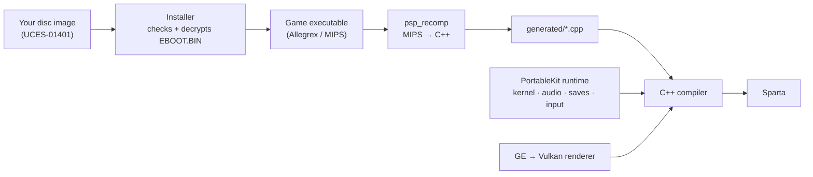

<div align="center">


# Sparta

**God of War: Ghost of Sparta (PSP), recompiled to run natively on your computer and phone.**

[](docs/MISSING.md)
[](#windows)
[](#macos)
[](#android)
[](LICENSE)

**English** · [Português (Brasil)](README.pt-BR.md)

</div>

---

Sparta is a native port made by **static recompilation**: the game's PSP code is translated ahead of time into C++ and compiled for your machine, then run on a reimplementation of the PSP's system software, drawing through Vulkan. No emulator, no JIT.

> [!WARNING]
> **Alpha.** Only the beginning of the game has been played so far. Expect bugs, graphical glitches and crashes.

> [!IMPORTANT]
> **No game data is included.** You need your own copy of the game: the **European release, `UCES-01401`**, as an uncompressed `.iso` of your own UMD. Nobody here can give you a copy or tell you where to get one. Sparta is not affiliated with Sony Interactive Entertainment, Santa Monica Studio or Ready At Dawn.

## Download and play

Get the latest build from the [**releases page**](https://github.com/arnaldolima1/gow-ghost-of-sparta-pc/releases). On every platform the first start asks for your `.iso`, checks it, and from then on goes straight to the game.

### Windows

1. Download `sparta-<version>-windows-x64.zip` and unzip it anywhere (not inside Program Files).
2. Start **Sparta.exe**. If SmartScreen stops it (the program is not signed): **More info › Run anyway**.
3. Pick your `.iso`.

Needs Windows 10 or 11 (64-bit) and a graphics card with Vulkan and up-to-date drivers.

### macOS

1. Open `sparta-<version>-macos-arm64.dmg` and drag **Sparta** into Applications.
2. The first time, macOS refuses to open it (it is not notarized): choose **Done**, then **System Settings › Privacy & Security › Open Anyway**.
3. Pick your `.iso`.

Needs a Mac with Apple Silicon (M1 or newer).

### Android

1. Install `sparta-<version>-android-arm64.apk` (allow installing apps from your browser or file manager).
2. Pick your `.iso` in the setup. It is copied into the app: about 2 GB free.

Needs a 64-bit phone or tablet with Android 10 or newer and Vulkan. Touch controls appear when you touch the screen; a gamepad works too, and Back opens the menu. On a mid-range phone, keep the internal resolution at ×2 (the default), or turn on *Limit to 30 fps* for a cooler phone.

## Controls

| PSP | Keyboard and mouse |
| --- | --- |
| Analog stick | <kbd>W</kbd> <kbd>A</kbd> <kbd>S</kbd> <kbd>D</kbd> |
| D-pad | Arrow keys |
| × (jump, confirm) | <kbd>Space</kbd> |
| □ (light attack) | <kbd>E</kbd> |
| △ (heavy attack) | Left mouse button |
| ○ (grab) | Right mouse button or <kbd>F</kbd> |
| L / R | <kbd>Q</kbd> / <kbd>Left Shift</kbd> |
| START / SELECT | <kbd>Enter</kbd> / <kbd>Backspace</kbd> |

PlayStation and Xbox gamepads work too. <kbd>Esc</kbd> (or L3+R3) opens the menu, where every key can be changed. START skips a cutscene. The interface is in English or Brazilian Portuguese (System › Language).

**HD texture packs** in PPSSPP's format work: Mods › *Import texture pack…* (they go in `mods/textures` in the data folder). Packs made for the North American release (`UCUS98737`) fit the European one.

## Remastered movies (mods)

Sparta can play sharper, larger versions of the cutscenes in place of the originals, keeping the game's own sound. Put `NAME.264` (for the game's movie `NAME`, e.g. `R6_INTRO.264` for the opening) in `mods\movies` inside the data folder (`%APPDATA%\Sparta\UCES01401` on Windows). Make them from your own disc with [Kit Movie Tools](https://github.com/arnaldolima1/kit-movie-tools): extract, upscale, then `python kit_movies.py install`. The **Mods** page in the launcher and the menu turns them on or off and shows how many were found. It also has the texture packs and the option to skip movies with START (on by default).

## Replacing game files (mods)

A file in `mods/files` inside the data folder is read in place of the disc's file at the same path: `mods/files/PSP_GAME/USRDIR/DATA/ENGLISH/FRONTEND.BIN` replaces `PSP_GAME/USRDIR/DATA/ENGLISH/FRONTEND.BIN` on the disc (upper or lower case, either works). It is how a translation, new models or sounds are put in without touching the disc image. Mods › *Replaced files* turns them off; *Open the files folder* shows where they go.

The game knows how large each of its files is, so a replacement the same size as the original is the safe one; a larger or smaller file has not been tried yet.

## Status

The title menu, the opening cutscene and the first level (the boat) play at **60 fps and full speed**:

| Platform | Tested on |
| --- | --- |
| **Windows** | Windows 11, AMD Radeon RX 7600 |
| **macOS** | macOS 26, Apple M4, up to ×5 internal resolution |
| **Android** | Moto g84 (Snapdragon 695) at ×2 |
| **Linux** | not tried yet |

What is known to be missing: [docs/MISSING.md](docs/MISSING.md). Performance work: [docs/PERFORMANCE.md](docs/PERFORMANCE.md).

## What's new

- **0.1.7 — Saves, shadows and remastered movies.** Save and load in any slot from a list; character shadows sit under them at the right size, without a dark box; the window fits the screen; the launcher can play music (`launcher/music.mp3`); and a new **Mods** page plays remastered cutscenes.
- **0.1.6 — Windows.** The first Windows build, compiled with clang-cl.
- **0.1.5 — Lighter game code.** The recompiler now lets the C++ compiler optimize across PSP instructions; the game's own code takes about 10% fewer CPU cycles.
- **0.1.4 — Faster on phones.** Small draws in a row with the same state are drawn as one; the boat's heaviest fights hold full speed on a Moto g84.

Older versions: see the [releases page](https://github.com/arnaldolima1/gow-ghost-of-sparta-pc/releases).

## How it works



1. **The installer** reads your disc image, checks that it is the supported release, and decrypts the game's executable.
2. **The recompiler** turns every function of the game's MIPS code into C++.
3. **The compiler** builds that C++ together with [PortableKit](https://github.com/TeamGDB/PortableKit)'s runtime: the PSP's kernel and system modules, audio, movies, saves, input, and a renderer that translates the PSP's graphics commands to Vulkan.

The framework changes this port needed live on the `sparta` branch of [a fork of PortableKit](https://github.com/arnaldolima1/PortableKit/tree/sparta), this repository's submodule.

## Building from source

Start with `git clone --recursive https://github.com/arnaldolima1/gow-ghost-of-sparta-pc.git`. Every build has the same steps: build the program, install the game from your `.iso`, recompile the game's code (`generated/`), and build again with it.

- **Windows:** [docs/WINDOWS.md](docs/WINDOWS.md) (Visual Studio 2022 with clang-cl, Ninja, the Vulkan SDK and SDL3).
- **macOS** (Apple Silicon, Xcode command line tools):

  ```bash
  brew install cmake ninja ccache python sdl3 molten-vk vulkan-loader vulkan-headers glslang ffmpeg
  scripts/build.sh                                              # the program, without the game's code
  build/dev/bin/SpartaNative --install /path/to/UCES01401.iso --in-place
  scripts/generate.sh                                           # recompile the game's code to C++
  scripts/build.sh                                              # compile it: ~15 minutes on an M4
  scripts/run.sh                                                # play
  ```

- **Android:** after the macOS steps, with the Android SDK, NDK and a JDK: `scripts/build_android.sh`, then `scripts/run_android.sh` to install it on a phone connected by USB.

<details>
<summary><b>Making a release</b></summary>

| Platform | Build | Publish |
| --- | --- | --- |
| macOS + Android | `scripts/release_macos.sh`, `scripts/release_android.sh` | `scripts/publish_release.sh` |
| Windows | `scripts\release_windows.ps1` | `scripts\publish_release_windows.ps1` |

The version comes from `VERSION`. When that version is already published, the release script raises its last number first and commits the change.

</details>

<details>
<summary><b>Repository layout</b></summary>

```text
.
├── CMakeLists.txt     # adds PortableKit and declares the SpartaNative target
├── VERSION            # the version the next release gets
├── host/              # the game's profile (sparta_profile.cpp) and keys
├── scripts/           # build, generate, run and release scripts (.sh; .ps1 for Windows)
├── tools/             # development helpers
├── packaging/         # icon, read-mes for each release, third-party notices
├── docs/              # MISSING.md, PERFORMANCE.md, WINDOWS.md
├── portablekit/       # submodule: the recompiler and runtime (fork, branch sparta)
│
│   # created locally, never committed:
├── generated/         # the recompiled game code
├── build/             # builds and logs
└── release/           # finished releases
```

</details>

<details>
<summary><b>Useful switches</b> (environment variables)</summary>

| Variable | What it does |
| --- | --- |
| `SPARTA_PERF=log` | One line a second: frame rate, speed, where the frame time went |
| `SPARTA_TRACE_STALLS=1` | Every frame longer than 40 ms, and what it waited on |
| `SPARTA_HALF_RATE=1` | *Limit to 30 fps*, for this run |
| `SPARTA_TEXTURE_PACK=/path/to/pack` | Use the texture pack in that folder, without installing it |
| `SPARTA_FLIP_UNLIMITED=1` | Turn the one-flip-a-vblank cap off, to compare |
| `SPARTA_NO_MOVIE_SKIP=1` | START does not skip movies |

PortableKit's [docs/BRINGING_UP_A_GAME.md](https://github.com/TeamGDB/PortableKit/blob/main/docs/BRINGING_UP_A_GAME.md) has the rest.

</details>

## Contributing

See [CONTRIBUTING.md](CONTRIBUTING.md). In short: English only, no game data of any kind, and a change that is true of the PSP rather than of this game belongs in PortableKit.

## Credits

- [TeamGDB](https://github.com/TeamGDB) for PortableKit, the recompiler and runtime this port stands on, and for [Yakumo](https://github.com/TeamGDB/Yakumo), [Tenkawa](https://github.com/TeamGDB/Tenkawa) and [Purun](https://github.com/TeamGDB/Purun), the ports it follows.
- The PSP scene's public documentation of the console, among it [psdevwiki](https://www.psdevwiki.com/psp/).
- [PPSSPP](https://www.ppsspp.org/), used as a reference for how the game behaves; no code from it is included.

## License

The code in this repository is MIT licensed ([LICENSE](LICENSE)). PortableKit and its third-party components keep their own licenses ([packaging/THIRD_PARTY_NOTICES.md](packaging/THIRD_PARTY_NOTICES.md)). *God of War* is a trademark of Sony Interactive Entertainment; the game itself is not covered by this license and is not included.
