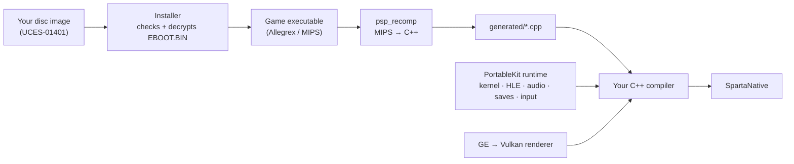

<div align="center">


# Sparta

**God of War: Ghost of Sparta (PSP), recompiled to run natively on your computer.**

[](docs/MISSING.md)
[](#playing-a-release)
[](#android)
[](#tech-stack)
[](#tech-stack)
[](https://github.com/TeamGDB/PortableKit)
[](LICENSE)

[Status](#status) · [What's new](#whats-new) · [Android](#android) · [How it works](#how-it-works) · [Tech stack](#tech-stack) · [Building](#building-and-playing) · [Controls](#controls) · [Credits](#credits)

</div>

---

Sparta is a native port made by **static recompilation**: the game's PSP code is translated ahead of time into C++ and compiled for your machine, then run on a reimplementation of the PSP system software, drawing on the GPU through Vulkan. It is not a decompilation, and not an emulator in the usual sense: there is no JIT and no interpreter in normal play.

> [!WARNING]
> **Work in progress.** Only the opening of the game has been played, on a Mac and an Android phone. Expect bugs, graphical glitches, crashes and breaking changes, including to where settings and saves are kept.

> [!IMPORTANT]
> **No game data is included.** This repository contains no disc image, no executable, no code generated from the game, and no art, audio or video from it. You need your own legally obtained copy of the game — the European release, `UCES-01401` — as a disc image of your own UMD. Nobody here can give you a copy or tell you where to get one. Sparta is not affiliated with, endorsed by or sponsored by Sony Interactive Entertainment, Santa Monica Studio or Ready At Dawn.

## Status

**The title menu, the opening cutscene and the first level (the boat) play** — recompiled, at 60 frames a second and full speed, with no audio underruns, on a Mac and on a mid-range Android phone.

| | |
| --- | --- |
| **macOS** | macOS 26, Apple Silicon (M4), Vulkan through MoltenVK: 60 fps and full speed throughout, up to ×5 internal resolution |
| **Android** | Moto g84 5G (Snapdragon 695, Adreno 619, Android 15): full speed at ×2, 60 fps, in the boat's heaviest fights ([details](#android)) |
| **Not tried yet** | Windows, Linux — PortableKit builds there; this port has never been run there |
| **Release** | `UCES-01401`, European, v1.00 — the installer checks the disc id and the SHA-256 of the executable |
| **Imports the game makes** | 206, of which 2 have no implementation (`sceKernelLoadExec`, `sceAtracSetAA3DataAndGetID`); neither has been seen called |
| **Recompiled** | 22 159 functions · 1 036 824 blocks · 254 C++ units |
| **Not lowered by the recompiler** | only the game's own 44 `break` traps |

What is known to be missing is in [`docs/MISSING.md`](docs/MISSING.md); where the frame time goes, and what is being done about it, in [`docs/PERFORMANCE.md`](docs/PERFORMANCE.md).

## What's new

Since 0.1.4:

- **Lighter game code.** The recompiler made every PSP instruction a place the game could jump into, which kept the C++ compiler from optimizing across instructions; it now makes entry points only where control can arrive from outside a block. Returns from functions jump straight back to their caller when it is in the same part of the code, and memory accesses no longer reload where the PSP's memory is after every store. On a Moto g84 the game's own code takes about 10% fewer CPU cycles. See [docs/PERFORMANCE.md](docs/PERFORMANCE.md).

Since 0.1.3:

- **Much faster on phones.** The game draws its scenes as some 6500 tiny pieces a frame; the renderer now takes the pieces drawn in a row with the same state as one, as PPSSPP does, instead of doing its whole work for each. On a Moto g84 the boat's heaviest fights now run at full speed at ×2 without skipping frames (they ran at about 90%).

Since 0.1.2:

- **Shadows and bloom drawn right.** The game masks its bloom with the GE's stencil test, which the renderer ignored, so the glow spread over the whole screen; and it draws every character's shadow map side by side in one buffer, then blurs and projects them from there, which the renderer kept as separate pictures, so the shadows were read from empty or stale pixels. Both are fixed in PortableKit.
- **Skip movies.** START (<kbd>Enter</kbd>) ends a pre-rendered cutscene.
- **HD texture packs**, in PPSSPP's format: Video → *Import texture pack…* checks a pack and installs it, on Android through the system's folder picker. Packs made for the North American release (`UCUS98737`) fit the European one: the textures are the same.
- **Limit to 30 fps** (Video): every other frame is drawn while the game keeps its full speed — half the work, for phones that cannot hold 60.
- **Volume starts at 30%**, the game being mixed loud.
- **Android app id is now `io.sparta`.** Version 0.1.3 installs beside 0.1.2 and older instead of over them; see [Android](#android) to carry your saves across.
- Faster on phones: the shown frame is no longer copied back into the PSP's memory every frame, which this game never reads.

Earlier, in 0.1.x: the launcher in the game's colours, English and Brazilian Portuguese, the first Android build, frame skipping, and renderer work for phones (from 45 to about 58 frames a second on the same phone).

## Android

Releases include `sparta-<version>-android-arm64.apk`: a 64-bit phone or tablet with **Android 10 or newer and Vulkan**. Install it, then pick the disc image of your own copy in the setup; the image is copied into the app (about 2 GB free, plus about 2 GB for an HD texture pack). Touch controls appear when you touch the screen, a gamepad works too, and the Back button opens the menu.

**Settings for a mid-range phone.** Measured on a Moto g84 in the boat's fights:

| Video setting | Result |
| --- | --- |
| ×2 internal resolution (the default) | full speed at 60 fps, with frames to spare |
| ×2, *Limit to 30 fps* | a steady 30 frames a second, for a cooler, longer-lasting phone |
| ×3 | the GPU is the limit: keep Frame skip on *Auto* |

**Coming from 0.1.2 or older.** The app's id changed from `io.github.arnaldolima1.sparta` to `io.sparta`, so Android sees a new app: it installs beside the old one and starts empty. In the old app, **System › Export save…**; in the new one, **System › Import save…**; then uninstall the old one.

## How it works



1. **The installer** reads your disc image, checks it is the supported release, and decrypts `EBOOT.BIN` into the game's executable.
2. **The recompiler** (`psp_recomp`) analyses that executable and writes every function of the game's Allegrex (MIPS) code as C++.
3. **Your compiler** builds that C++ together with the runtime: a reimplementation of the PSP kernel and system modules, audio (SAS, ATRAC3, movies), save data, input, and a GE renderer that translates the PSP's graphics command lists to Vulkan.

<details>
<summary><b>What this port needed beyond a profile of constants</b></summary>

- **PGD data.** One of the game's files (`ATT_000_STARTSCREEN.BIN`) is PGD-encrypted. The port carries the published PGD keys (`host/sparta_keys.cpp`), each checked against PortableKit's fingerprints.
- **New render targets start as zeros.** The game's bloom is drawn in steps side by side inside one 512-pixel-wide buffer and samples around what it drew; undefined target contents showed as a magenta tint over the whole picture.
- **One flip a vblank.** The game's frame loop waits only on the GE, which takes no emulated time here, so it flipped about ten times a vblank and then stalled for 100 ms at once. The profile caps it at one flip a vblank (`flips_wait_for_vblank`) — the same idea PPSSPP applies to the God of War games — and runs it at the game's own 60 frames a second.

- **The stencil test, and framebuffers inside other framebuffers.** The game marks surfaces in the stencil to limit its bloom, and draws its shadow maps 64 pixels apart in one buffer, blurring them as one texture. PortableKit's renderer had neither.
- **A phone that keeps up.** Frame skipping, cheaper framebuffer textures, render passes over only what is drawn, and *Limit to 30 fps*.

The framework changes live on the `sparta` branch of [a fork of PortableKit](https://github.com/arnaldolima1/PortableKit/tree/sparta), which this repository uses as its submodule, and are offered to PortableKit in [TeamGDB/PortableKit#44](https://github.com/TeamGDB/PortableKit/pull/44).

</details>

## Tech stack

| Layer | Technology |
| --- | --- |
| Recompiler and runtime | [PortableKit](https://github.com/TeamGDB/PortableKit) (C++20) — static MIPS → C++ recompiler, PSP kernel and HLE system modules |
| Graphics | Vulkan, through [MoltenVK](https://github.com/KhronosGroup/MoltenVK) on macOS; shaders in GLSL compiled to SPIR-V with `glslangValidator` |
| Window, input, audio output | [SDL3](https://github.com/libsdl-org/SDL) |
| Music and movies | [FFmpeg](https://ffmpeg.org/) (LGPL, ATRAC3/ATRAC3plus and H.264 decoders only) |
| Interface | [Dear ImGui](https://github.com/ocornut/imgui) — first-run setup, the launcher and the in-game menu |
| Build | CMake + Ninja, `ccache` |
| Packaging | PortableKit's release scripts: ad-hoc-signed `.app` in a `.dmg`; an APK signed with the port's release key |

## Repository layout

```text
.
├── CMakeLists.txt            # adds PortableKit and declares the SpartaNative target
├── VERSION                   # the version the next release gets
├── host/
│   ├── sparta_profile.cpp    # the game's profile: disc id, hashes, memory, saves, quirks
│   └── sparta_keys.cpp       # the console keys, with the PGD keys this game needs
├── scripts/
│   ├── generate.sh           # recompile the game's executable into generated/
│   ├── build.sh              # the everyday build, in build/dev/
│   ├── build_status.sh       # is the last build running, done or failed?
│   ├── run.sh                # play
│   ├── release_macos.sh      # build a release: Sparta.app and the .dmg in release/macos/
│   ├── build_android.sh      # build an APK, in build/android/
│   ├── run_android.sh        # install it on a connected phone and start it
│   ├── release_android.sh    # the release's APK, in release/android/
│   ├── bench_android.sh      # measure a stretch of play on a phone (docs/PERFORMANCE.md)
│   ├── publish_release.sh    # put the release on GitHub
│   └── common.sh             # the paths the scripts share
├── tools/
│   ├── decrypt_eboot.cpp     # development helper: decrypt EBOOT.BIN, print its hash
│   └── perf/                 # reports on a phone's simpleperf profiles
├── packaging/                # icon, release description, .dmg read-me, third-party notices
├── docs/
│   ├── MISSING.md            # what is known to be missing
│   └── PERFORMANCE.md        # where the frame time goes, done and next
├── portablekit/              # submodule: the recompiler and runtime (fork, branch sparta)
│
│   # created locally, never committed:
├── generated/                # the recompiled game code
├── build/                    # dev/, release/, logs/, analysis/ ...
└── release/                 # a finished release: macos/, android/
```

## Playing a release

Releases are on the [releases page](https://github.com/arnaldolima1/gow-ghost-of-sparta-pc/releases): a macOS disk image and an Android APK ([Android](#android) has the details). The macOS image (Apple Silicon) holds `Sparta.app` and a read-me: drag Sparta into Applications, allow it once in **System Settings › Privacy & Security** (it is signed ad hoc, not notarized), and pick your disc image at the first start. No build tools, no recompiling.

## Building and playing

You need macOS on Apple Silicon (the only tested platform), the Xcode command line tools, and:

```bash
brew install cmake ninja ccache python sdl3 molten-vk vulkan-loader vulkan-headers glslang ffmpeg
```

Then:

```bash
git clone --recursive https://github.com/arnaldolima1/gow-ghost-of-sparta-pc.git
cd gow-ghost-of-sparta-pc
scripts/build.sh                                                  # the bootstrap: minutes
build/dev/bin/SpartaNative --install /path/to/your/UCES01401.iso --in-place
scripts/generate.sh                                               # recompile the game's code to C++: ~3 minutes
scripts/build.sh                                                  # compile it: ~15 minutes on an M4
scripts/run.sh                                                    # play
```

> [!TIP]
> - **Forgot `--recursive`?** Run `git submodule update --init --recursive`.
> - **`--in-place`** plays from the disc image where it is instead of copying it.
> - **Without the generate step** the game still runs, under PortableKit's interpreter, about twenty times slower: a development tool, not a way to play.
> - `scripts/build_status.sh` says whether the last build is still running, finished or failed; its log is `build/logs/build.log`.

### Building for Android

With the recompiled code in `generated/` (the steps above), the Android SDK and NDK, and a JDK:

```bash
scripts/build_android.sh     # build/android/dist/Sparta-android-arm64.apk
scripts/run_android.sh       # install it on the phone connected by USB, and start it
```

Without a key of your own the APK is signed with a test key; `KEYSTORE`, `KEYSTORE_PASS` and `KEY_ALIAS` name yours, so later builds install over earlier ones. `DEBUGGABLE=1` builds an APK whose `SPARTA_*` switches can be set in `env.txt` in the app's storage (`adb shell run-as io.sparta`).

### Making a release

```bash
scripts/release_macos.sh     # Sparta.app, the .dmg and checksums, in release/macos/
scripts/release_android.sh   # the APK, signed with the release key, in release/android/
scripts/publish_release.sh   # tag it and put both on the GitHub releases page
```

The version comes from `VERSION`. When that version is already published, `release_macos.sh` raises its last number first (0.1.0 → 0.1.1 → 0.1.2) and commits the change, so every release gets a new version. PortableKit checks the program against the macOS 13 SDK; without it installed the script checks against the newest macOS 15 SDK instead, so macOS 13 and 14 are then not verified.

## Controls

| PSP | Keyboard and mouse |
| --- | --- |
| Analog stick | <kbd>W</kbd> <kbd>A</kbd> <kbd>S</kbd> <kbd>D</kbd> |
| D-pad | Arrow keys |
| × (jump, confirm) | <kbd>Space</kbd> |
| □ (light attack) | <kbd>E</kbd> |
| △ (heavy attack) | Left mouse button |
| ○ (grab) | Right mouse button or <kbd>F</kbd> |
| L / R | <kbd>Q</kbd> / <kbd>Left Shift</kbd> |
| START / SELECT | <kbd>Enter</kbd> / <kbd>Backspace</kbd> |

A PlayStation or Xbox gamepad works too. <kbd>Esc</kbd> (or L3+R3) opens the menu: controls, video, audio, saves.

During a pre-rendered cutscene, START (<kbd>Enter</kbd>) skips it.

Before the game starts, a launcher has the same settings, quick settings and a Play button; it backs your saves up each time you play. The interface is in English or Brazilian Portuguese (System → Language). `--play` skips the launcher once, `--launcher` brings it back if you turned it off.

## Useful switches

<details>
<summary>Every switch takes the <code>SPARTA_</code> prefix</summary>

| Variable | What it does |
| --- | --- |
| `SPARTA_PERF=log` | One line a second: frame rate, emulation speed, where the frame time went |
| `SPARTA_TRACE_STALLS=1` | Every frame longer than 40 ms, and what it waited on |
| `SPARTA_FLIP_UNLIMITED=1` | Turn the one-flip-a-vblank cap off, to compare |
| `SPARTA_NO_TARGET_CLEAR=1` | Leave new render targets undefined, as PortableKit did before |
| `SPARTA_HALF_RATE=1` | *Limit to 30 fps*, for this run |
| `SPARTA_TEXTURE_PACK=/path/to/pack` | Use the texture pack in that folder, without installing it |
| `SPARTA_NO_STENCIL=1` | Ignore the GE's stencil test, as PortableKit did before |
| `SPARTA_NO_TARGET_ALIASES=1` | Keep a separate picture for every framebuffer address, as before (breaks the shadows) |
| `SPARTA_NO_MOVIE_SKIP=1` | START does not skip movies |

PortableKit's [`docs/BRINGING_UP_A_GAME.md`](https://github.com/TeamGDB/PortableKit/blob/main/docs/BRINGING_UP_A_GAME.md) has the rest.

</details>

## Contributing

See [`CONTRIBUTING.md`](CONTRIBUTING.md). In short: English only, no game data of any kind, and a change that is true of the PSP rather than of this game belongs in PortableKit.

## Credits

- [TeamGDB](https://github.com/TeamGDB) for PortableKit (MIT), the recompiler and runtime this port stands on, and for [Yakumo](https://github.com/TeamGDB/Yakumo), [Tenkawa](https://github.com/TeamGDB/Tenkawa) and [Purun](https://github.com/TeamGDB/Purun), the ports it follows.
- The PSP scene's public documentation of the console's formats and keys, among it [psdevwiki](https://www.psdevwiki.com/psp/).
- [PPSSPP](https://www.ppsspp.org/), used as a reference for how the game behaves; no code from it is included.

## License

The code in this repository is MIT licensed (see [`LICENSE`](LICENSE)). PortableKit and its third-party components keep their own licences. *God of War* is a trademark of Sony Interactive Entertainment; the game itself is not covered by this licence and is not included.
