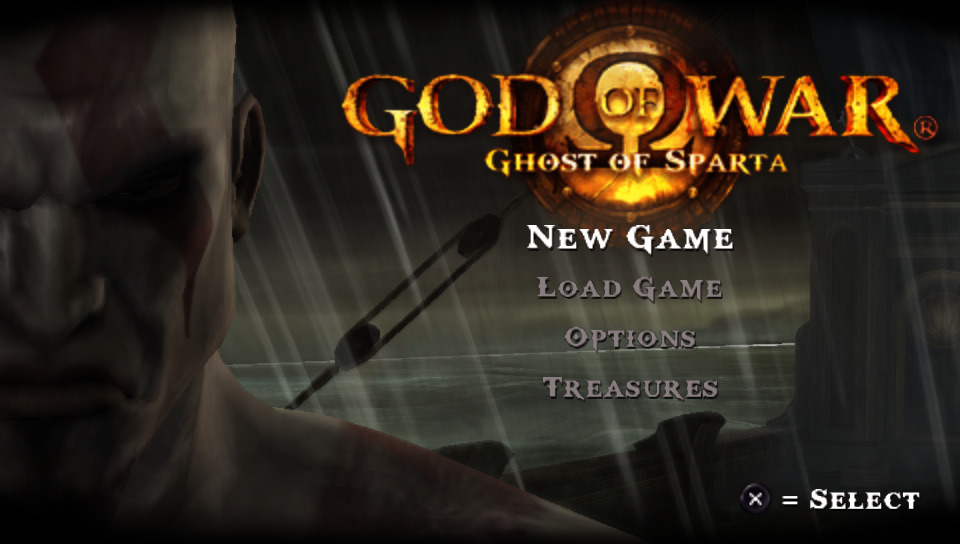

# Sparta

A native port of **God of War: Ghost of Sparta** (PlayStation Portable) made by static recompilation: the game's PSP code is translated ahead of time into C++ and compiled for your machine, then run on a reimplementation of the PSP system software. It draws with Vulkan on the GPU. It is not a decompilation and not an emulator in the usual sense: there is no JIT and no interpreter in normal play.



> **Work in progress.** Only the opening of the game has been played, on one machine. Expect bugs, graphical glitches, crashes and breaking changes, including to where settings and saves are kept.

> **No game data is included.** This repository contains no disc image, no executable, no code generated from the game, and no audio, video or textures from it. You need your own legally obtained copy of the game — the European release, `UCES-01401` — as a disc image of your own UMD. Nobody here can give you a copy or tell you where to get one. Sparta is not affiliated with, endorsed by or sponsored by Sony Interactive Entertainment, Santa Monica Studio or Ready At Dawn.

## Status

**Boots, plays the title menu, the opening cutscene and the first level (the boat)** — recompiled, at 60 frames a second and full speed, on macOS with Apple Silicon.

| | |
| --- | --- |
| Tested on | macOS 26 on Apple Silicon (M4), Vulkan through MoltenVK. **Windows, Linux and Android have not been tried**; the framework builds there, this port has never been run there |
| Release | `UCES-01401`, European, version 1.00 (the installer checks the disc id and the SHA-256 of the executable) |
| Imports the game makes | 206 |
| Of those, with no implementation | 2 (`sceKernelLoadExec`, `sceAtracSetAA3DataAndGetID`); neither has been seen called |
| Recompiled | 22159 functions, 1036824 blocks, 254 C++ units |
| Addresses the recompiler cannot lower | the game's own 44 `break` traps, and nothing else |

[`docs/MISSING.md`](docs/MISSING.md) has what is known to be missing.

## How it works

Sparta is a *profile* on top of [PortableKit](https://github.com/TeamGDB/PortableKit), the shared static recompiler and runtime made by TeamGDB for [Yakumo](https://github.com/TeamGDB/Yakumo), [Tenkawa](https://github.com/TeamGDB/Tenkawa) and [Purun](https://github.com/TeamGDB/Purun):

1. **The installer** reads your disc image, checks it is the supported release, and decrypts `EBOOT.BIN` into the game's executable.
2. **The recompiler** (`psp_recomp`) analyses that executable and writes every function of the game's Allegrex (MIPS) code as C++.
3. **Your compiler** builds that C++ together with the runtime: a reimplementation of the PSP kernel and system modules, audio (SAS, ATRAC3, movies through FFmpeg), save data, input, and a GE renderer that translates the PSP's graphics command lists to Vulkan.

What this port needed beyond a profile of constants:

- **PGD data.** One of the game's files (`ATT_000_STARTSCREEN.BIN`) is PGD-encrypted. The port carries the published PGD keys (`host/sparta_keys.cpp`), each checked against PortableKit's fingerprints.
- **New render targets start as zeros.** The game's bloom is drawn in steps side by side inside one 512-pixel-wide buffer and samples around what it drew; undefined target contents showed as a magenta tint over the whole picture.
- **One flip a vblank.** The game's frame loop waits only on the GE, which takes no emulated time here, so it flipped about ten times a vblank and then stalled for 100 ms at once. The profile caps it at one flip a vblank (`flips_wait_for_vblank`), the same idea PPSSPP applies to the God of War games, and runs it at the game's own 60 frames a second.

The two framework changes live on the `sparta` branch of [a fork of PortableKit](https://github.com/arnaldolima1/PortableKit/tree/sparta), which this repository uses as its submodule.

## Playing a release

A release is a macOS disk image (Apple Silicon) with `Sparta.app` and a read-me: drag Sparta into Applications, allow it once in System Settings > Privacy & Security (it is signed ad hoc, not notarized), and pick your disc image at the first start. No build tools, no recompiling. Releases are on the [releases page](https://github.com/arnaldolima1/gow-ghost-of-sparta-pc/releases).

To make one yourself, after the generate step below: `scripts/release_macos.sh` builds a Release configuration with PortableKit's bundled FFmpeg and packs `out/release-macos/dist/`. PortableKit checks the program against the macOS 13 SDK; without it installed the script checks against the newest macOS 15 SDK instead, so macOS 13 and 14 are then not verified.

## Building and playing

You need macOS on Apple Silicon (the only tested platform), the Xcode command line tools, and:

```bash
brew install cmake ninja ccache python sdl3 molten-vk vulkan-loader vulkan-headers glslang ffmpeg
```

Then:

```bash
git clone --recursive https://github.com/arnaldolima1/gow-ghost-of-sparta-pc.git
cd gow-ghost-of-sparta-pc
cmake -S . -B out -G Ninja -DCMAKE_BUILD_TYPE=Release -DPORTABLEKIT_FFMPEG=system
cmake --build out -j4                                   # the bootstrap: minutes
out/bin/SpartaNative --install /path/to/your/UCES01401.iso --in-place
scripts/generate.sh out                                 # recompile the game's code to C++: ~3 minutes
scripts/build.sh                                        # compile it: ~15 minutes on an M4
scripts/run.sh                                          # play
```

- **Forgot `--recursive`?** Run `git submodule update --init --recursive`.
- **`--in-place`** plays from the disc image where it is instead of copying it.
- **Without the generate step** the game still runs, under PortableKit's interpreter, about twenty times slower: a development tool, not a way to play.
- `scripts/build_status.sh` says whether a build started with `scripts/build.sh` is still running, finished or failed.

### Controls

| PSP | Keyboard and mouse |
| --- | --- |
| Analog stick | W A S D |
| D-pad | Arrow keys |
| × (jump, confirm) | Space |
| □ (light attack) | E |
| △ (heavy attack) | Left mouse button |
| ○ (grab) | Right mouse button or F |
| L / R | Q / Left Shift |
| START / SELECT | Enter / Backspace |

A PlayStation or Xbox gamepad works too. **Esc** (or L3+R3) opens the menu: controls, video, audio, saves.

## Useful switches

Every switch takes the `SPARTA_` prefix.

| Variable | What it does |
| --- | --- |
| `SPARTA_PERF=log` | One line a second: frame rate, emulation speed, where the frame time went |
| `SPARTA_TRACE_STALLS=1` | Every frame longer than 40 ms, and what it waited on |
| `SPARTA_FLIP_UNLIMITED=1` | Turn the one-flip-a-vblank cap off, to compare |
| `SPARTA_NO_TARGET_CLEAR=1` | Leave new render targets undefined, as PortableKit did before |

PortableKit's [`docs/BRINGING_UP_A_GAME.md`](https://github.com/TeamGDB/PortableKit/blob/main/docs/BRINGING_UP_A_GAME.md) has the rest.

## Credits

- [TeamGDB](https://github.com/TeamGDB) for PortableKit (MIT), the recompiler and runtime this port stands on.
- The PSP scene's public documentation of the console's formats and keys, among it [psdevwiki](https://www.psdevwiki.com/psp/).
- [PPSSPP](https://www.ppsspp.org/), used as a reference for how the game behaves; no code from it is included.

## License

The code in this repository is MIT licensed (see `LICENSE`). PortableKit and its third-party components keep their own licences. God of War is a trademark of Sony Interactive Entertainment; the game itself is not covered by this licence and is not included.
