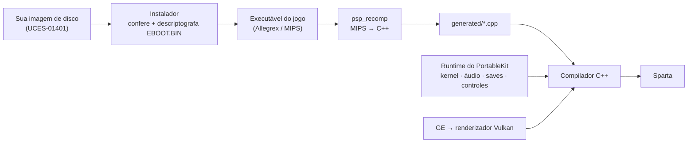

<div align="center">


# Sparta

**God of War: Ghost of Sparta (PSP), recompilado para rodar nativamente no seu computador e celular.**

[](docs/MISSING.md)
[](#windows)
[](#macos)
[](#android)
[](LICENSE)

[English](README.md) · **Português (Brasil)**

</div>

---

O Sparta é um port nativo feito por **recompilação estática**: o código do jogo para PSP é traduzido antecipadamente para C++ e compilado para a sua máquina, rodando sobre uma reimplementação do software de sistema do PSP, com gráficos em Vulkan. Não é emulador, não tem JIT.

> [!WARNING]
> **Versão alfa.** Até agora só o começo do jogo foi jogado. Espere bugs, falhas gráficas e travamentos.

> [!IMPORTANT]
> **Nenhum dado do jogo está incluído.** Você precisa da sua própria cópia: a **versão europeia, `UCES-01401`**, como um `.iso` sem compressão do seu próprio UMD. Ninguém aqui pode te dar uma cópia nem dizer onde conseguir. O Sparta não tem ligação com a Sony Interactive Entertainment, a Santa Monica Studio ou a Ready At Dawn.

## Baixar e jogar

Baixe a versão mais recente na [**página de releases**](https://github.com/arnaldolima1/gow-ghost-of-sparta-pc/releases). Em todas as plataformas, a primeira vez que você abre ele pede o seu `.iso`, confere, e daí em diante já entra direto no jogo.

### Windows

1. Baixe `sparta-<versão>-windows-x64.zip` e descompacte onde quiser (fora de Arquivos de Programas).
2. Abra o **Sparta.exe**. Se o SmartScreen bloquear (o programa não é assinado): **Mais informações › Executar assim mesmo**.
3. Escolha o seu `.iso`.

Precisa de Windows 10 ou 11 (64 bits) e uma placa de vídeo com Vulkan e drivers atualizados.

### macOS

1. Abra `sparta-<versão>-macos-arm64.dmg` e arraste o **Sparta** para Aplicativos.
2. Na primeira vez o macOS se recusa a abrir (o app não é notarizado): escolha **OK** e depois **Ajustes do Sistema › Privacidade e Segurança › Abrir Mesmo Assim**.
3. Escolha o seu `.iso`.

Precisa de um Mac com Apple Silicon (M1 ou mais novo).

### Android

1. Instale `sparta-<versão>-android-arm64.apk` (permita instalar apps pelo navegador ou gerenciador de arquivos).
2. Escolha o seu `.iso` na configuração inicial. Ele é copiado para dentro do app: precisa de uns 2 GB livres.

Precisa de um celular ou tablet de 64 bits com Android 10 ou mais novo e Vulkan. Os controles de toque aparecem quando você toca na tela; controle (gamepad) também funciona, e o botão Voltar abre o menu. Em celular intermediário, deixe a resolução interna em ×2 (o padrão), ou ligue *Limitar a 30 fps* para o celular esquentar menos.

## Controles

| PSP | Teclado e mouse |
| --- | --- |
| Analógico | <kbd>W</kbd> <kbd>A</kbd> <kbd>S</kbd> <kbd>D</kbd> |
| Direcional | Setas |
| × (pular, confirmar) | <kbd>Espaço</kbd> |
| □ (ataque leve) | <kbd>E</kbd> |
| △ (ataque forte) | Botão esquerdo do mouse |
| ○ (agarrar) | Botão direito do mouse ou <kbd>F</kbd> |
| L / R | <kbd>Q</kbd> / <kbd>Shift esquerdo</kbd> |
| START / SELECT | <kbd>Enter</kbd> / <kbd>Backspace</kbd> |

Controles de PlayStation e Xbox também funcionam. <kbd>Esc</kbd> (ou L3+R3) abre o menu, onde dá para trocar qualquer tecla. START pula uma cena. A interface está em inglês ou português do Brasil (Sistema › Idioma).

**Pacotes de texturas HD** no formato do PPSSPP funcionam: Mods › *Importar pacote de texturas…* (eles ficam em `mods/textures` na pasta de dados). Pacotes feitos para a versão norte-americana (`UCUS98737`) servem na europeia.

## Vídeos remasterizados (mods)

O Sparta pode tocar versões mais nítidas e maiores das cutscenes no lugar das originais, mantendo o som do próprio jogo. Coloque `NOME.264` (para o vídeo `NOME` do jogo, ex.: `R6_INTRO.264` para a abertura) em `mods\movies` dentro da pasta de dados (`%APPDATA%\Sparta\UCES01401` no Windows). Gere os vídeos a partir do seu próprio disco com o [Kit Movie Tools](https://github.com/arnaldolima1/kit-movie-tools): extraia, remasterize e depois `python kit_movies.py install`. A aba **Mods** do launcher e do menu liga ou desliga e mostra quantos foram encontrados. Nela também ficam os pacotes de texturas e a opção de pular vídeos com START (ligada por padrão).

## Substituir arquivos do jogo (mods)

Um arquivo em `mods/files` dentro da pasta de dados é lido no lugar do arquivo do disco no mesmo caminho: `mods/files/PSP_GAME/USRDIR/DATA/ENGLISH/FRONTEND.BIN` substitui `PSP_GAME/USRDIR/DATA/ENGLISH/FRONTEND.BIN` do disco (maiúsculas ou minúsculas, tanto faz). É assim que entram uma tradução, modelos ou sons novos sem mexer na imagem do disco. Mods › *Arquivos substituídos* os desliga; *Abrir a pasta de arquivos* mostra onde ficam.

O jogo sabe o tamanho de cada um dos seus arquivos, então o substituto seguro tem o mesmo tamanho do original; um arquivo maior ou menor ainda não foi testado.

## Situação

O menu inicial, a cena de abertura e a primeira fase (o barco) rodam a **60 fps e velocidade total**:

| Plataforma | Testado em |
| --- | --- |
| **Windows** | Windows 11, AMD Radeon RX 7600 |
| **macOS** | macOS 26, Apple M4, até ×5 de resolução interna |
| **Android** | Moto g84 (Snapdragon 695) em ×2 |
| **Linux** | ainda não testado |

O que se sabe que falta: [docs/MISSING.md](docs/MISSING.md). Trabalho de desempenho: [docs/PERFORMANCE.md](docs/PERFORMANCE.md) (em inglês).

## Novidades

- **0.1.7 — Saves, sombras e vídeos remasterizados.** Salve e carregue em qualquer slot por uma lista; as sombras dos personagens ficam embaixo deles, no tamanho certo e sem o quadrado escuro; a janela cabe na tela; o launcher pode tocar música (`launcher/music.mp3`); e uma nova aba **Mods** toca cutscenes remasterizadas.
- **0.1.6 — Windows.** A primeira versão para Windows, compilada com clang-cl.
- **0.1.5 — Código do jogo mais leve.** O recompilador agora deixa o compilador C++ otimizar entre instruções do PSP; o código do próprio jogo gasta uns 10% menos ciclos de CPU.
- **0.1.4 — Mais rápido no celular.** Desenhos pequenos seguidos com o mesmo estado viram um só; as lutas mais pesadas do barco ficam em velocidade total num Moto g84.

Versões anteriores: veja a [página de releases](https://github.com/arnaldolima1/gow-ghost-of-sparta-pc/releases).

## Como funciona



1. **O instalador** lê a sua imagem de disco, confere se é a versão suportada e descriptografa o executável do jogo.
2. **O recompilador** transforma cada função do código MIPS do jogo em C++.
3. **O compilador** junta esse C++ com o runtime do [PortableKit](https://github.com/TeamGDB/PortableKit): o kernel e os módulos de sistema do PSP, áudio, vídeos, saves, controles e um renderizador que traduz os comandos gráficos do PSP para Vulkan.

As mudanças no framework que este port precisou estão no branch `sparta` de [um fork do PortableKit](https://github.com/arnaldolima1/PortableKit/tree/sparta), o submódulo deste repositório.

## Compilando o código

Comece com `git clone --recursive https://github.com/arnaldolima1/gow-ghost-of-sparta-pc.git`. Todo build segue os mesmos passos: compilar o programa, instalar o jogo a partir do seu `.iso`, recompilar o código do jogo (`generated/`) e compilar de novo com ele.

- **Windows:** [docs/WINDOWS.md](docs/WINDOWS.md) (Visual Studio 2022 com clang-cl, Ninja, Vulkan SDK e SDL3; em inglês).
- **macOS** (Apple Silicon, ferramentas de linha de comando do Xcode):

  ```bash
  brew install cmake ninja ccache python sdl3 molten-vk vulkan-loader vulkan-headers glslang ffmpeg
  scripts/build.sh                                              # o programa, sem o código do jogo
  build/dev/bin/SpartaNative --install /caminho/para/UCES01401.iso --in-place
  scripts/generate.sh                                           # recompila o código do jogo para C++
  scripts/build.sh                                              # compila: ~15 minutos num M4
  scripts/run.sh                                                # jogar
  ```

- **Android:** depois dos passos do macOS, com o Android SDK, o NDK e um JDK: `scripts/build_android.sh`, e depois `scripts/run_android.sh` para instalar num celular ligado por USB.

<details>
<summary><b>Gerando uma release</b></summary>

| Plataforma | Build | Publicar |
| --- | --- | --- |
| macOS + Android | `scripts/release_macos.sh`, `scripts/release_android.sh` | `scripts/publish_release.sh` |
| Windows | `scripts\release_windows.ps1` | `scripts\publish_release_windows.ps1` |

A versão vem do arquivo `VERSION`. Se essa versão já foi publicada, o script de release primeiro aumenta o último número e faz commit da mudança.

</details>

<details>
<summary><b>Estrutura do repositório</b></summary>

```text
.
├── CMakeLists.txt     # adiciona o PortableKit e declara o alvo SpartaNative
├── VERSION            # a versão que a próxima release recebe
├── host/              # o perfil do jogo (sparta_profile.cpp) e as chaves
├── scripts/           # scripts de build, geração, execução e release (.sh; .ps1 no Windows)
├── tools/             # ferramentas de desenvolvimento
├── packaging/         # ícone, leia-mes de cada release, avisos de terceiros
├── docs/              # MISSING.md, PERFORMANCE.md, WINDOWS.md
├── portablekit/       # submódulo: o recompilador e o runtime (fork, branch sparta)
│
│   # criados localmente, nunca vão para o git:
├── generated/         # o código recompilado do jogo
├── build/             # builds e logs
└── release/           # releases prontas
```

</details>

<details>
<summary><b>Opções úteis</b> (variáveis de ambiente)</summary>

| Variável | O que faz |
| --- | --- |
| `SPARTA_PERF=log` | Uma linha por segundo: fps, velocidade, para onde foi o tempo do frame |
| `SPARTA_TRACE_STALLS=1` | Todo frame acima de 40 ms, e o que ele esperou |
| `SPARTA_HALF_RATE=1` | *Limitar a 30 fps*, só nesta execução |
| `SPARTA_TEXTURE_PACK=/caminho/do/pacote` | Usa o pacote de texturas dessa pasta, sem instalar |
| `SPARTA_FLIP_UNLIMITED=1` | Desliga o limite de um flip por vblank, para comparar |
| `SPARTA_NO_MOVIE_SKIP=1` | START não pula vídeos |

O [docs/BRINGING_UP_A_GAME.md](https://github.com/TeamGDB/PortableKit/blob/main/docs/BRINGING_UP_A_GAME.md) do PortableKit tem o resto.

</details>

## Contribuindo

Veja o [CONTRIBUTING.md](CONTRIBUTING.md). Resumindo: contribuições em inglês, nenhum dado do jogo de nenhum tipo, e uma mudança que vale para o PSP em geral (e não só para este jogo) vai para o PortableKit.

## Créditos

- [TeamGDB](https://github.com/TeamGDB), pelo PortableKit, o recompilador e runtime em que este port se apoia, e por [Yakumo](https://github.com/TeamGDB/Yakumo), [Tenkawa](https://github.com/TeamGDB/Tenkawa) e [Purun](https://github.com/TeamGDB/Purun), os ports que ele segue.
- A documentação pública da cena do PSP sobre o console, entre ela a [psdevwiki](https://www.psdevwiki.com/psp/).
- O [PPSSPP](https://www.ppsspp.org/), usado como referência de como o jogo se comporta; nenhum código dele está incluído.

## Licença

O código deste repositório é licenciado sob MIT ([LICENSE](LICENSE)). O PortableKit e seus componentes de terceiros mantêm suas próprias licenças ([packaging/THIRD_PARTY_NOTICES.md](packaging/THIRD_PARTY_NOTICES.md)). *God of War* é marca registrada da Sony Interactive Entertainment; o jogo em si não é coberto por esta licença e não está incluído.
